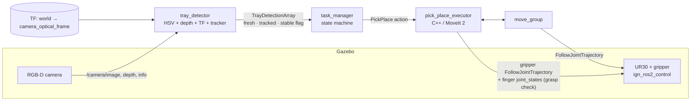

# Vision-Guided Café Tray Pick-and-Place (ROS 2 Humble · UR30 · MoveIt 2 · Gazebo)

A camera detects coloured food trays lying randomly on a kitchen table; a **UR30 with a parallel gripper**
picks each tray and puts it in the serving area that belongs to its colour. Handles missing trays,
failed grasps (retry → skip), trays that are moved while running, and colour priority.

| | |
|---|---|
| OS / ROS | Ubuntu 22.04, ROS 2 Humble |
| Simulator | Gazebo Fortress (`ign`, default) **or** Gazebo Harmonic (`gz`, `gz:=true` / Docker `GZ=harmonic`) + RViz2 |
| Arm / gripper | UR30 (official `ur_description`) + custom 2-finger parallel gripper (URDF in `cafe_sim`) |
| Planning | MoveIt 2 (OMPL RRTConnect for free motion, Cartesian paths for approach/lift/place) |
| Perception | Overhead RGB-D camera, OpenCV HSV segmentation + depth, TF2 camera→world |

## 1. Architecture



| Package | Role |
|---|---|
| `cafe_interfaces` | `TrayDetection(.Array)` msgs, `PickPlace` action (typed error codes) |
| `cafe_sim` | URDF/xacro (UR30 + gripper + ros2_control), Gazebo world, controllers, `sim.launch.py`, `randomize_trays.py` |
| `cafe_moveit_config` | SRDF, KDL kinematics, OMPL, joint limits, controller mapping |
| `tray_detector` | Perception node. `core.py` is ROS-free and unit-tested |
| `pick_place_executor` | Pick/place action server: planning, grasp verification, recovery |
| `task_manager` | Detect → prioritise → execute → retry/skip → idle |
| `cafe_bringup` | One parameter file, **XML launch files**, RViz config |

### Frames / geometry
`world` = Gazebo world (floor z=0, table top z=0.75). Robot base is on the table at the origin. The camera is
fixed at (0.75, 0, 1.75) looking straight down; the static TF `world → camera_optical_frame` is published by
`sim.launch.py`. The detector de-projects pixel+depth into the camera frame and transforms with **tf2** into
`world`. Pick area x∈[0.4,1.1], y∈[-0.5,0.5]; serving areas at y=0.72 (red x=0.05, blue 0.33, green 0.61).

## 2. How each requirement is met

| Req. | Implementation |
|---|---|
| 5.1 Detection (3 tray types, 3D position) | HSV mask per colour → `minAreaRect` → median depth of tray top → 3D pose + yaw + size |
| 5.2 Pick & place | open → pre-grasp (OMPL) → Cartesian descent → close → verify → Cartesian lift → plan above drop → descend → release → retreat → observe pose |
| 5.3 No tray | `IDLE`, re-scan every `rescan_interval` s (arm parked out of the camera view at an *observe* pose) |
| 5.4 Pick/grasp failure | Grasp verified from finger joint states (opening must equal tray width). Fail → open, retreat, return error code. Task manager retries up to `max_retries`, then **skips** (blacklists) the tray |
| 5.5 Dynamic update | Detections are per-frame (never cached), carry the image stamp; manager ignores anything older than `max_detection_age`. Tracker gives a `stable` flag – a tray is only picked once it stopped moving. A moved/skipped tray gets a new id / un-skip |
| 5.6 Priority (bonus) | `priority_order: [red, blue, green]`, nearest-first within a class; `priority_enabled:false` → nearest first |
| TF | camera→world transform inside the detector; MoveIt/TF for robot frames |
| Motion planning / grasp logic | MoveIt OMPL + Cartesian paths + TOTG time parameterisation; table collision object; gripper aligned across the tray's short side |

### Edge cases / "innovation"
* Gripper orientation is computed from tray yaw so it always clamps across the **short** side; if unreachable it retries with yaw+π (gripper is symmetric).
* Depth plausibility check (tray top must be 1.5–9 cm above the table), ROI, size and image-border rejection.
* Tray lost during lift/transit detected (`TRAY_DROPPED`); if the drop zone is unreachable the tray is **put back**.
* Same-colour trays are placed in side-by-side slots (`max_slots`).
* Services: `/task_manager/{start,pause,reset}`, status topics `/task_manager/{state,stats}` (JSON counters).

## 3. Setup

```bash
sudo apt update
sudo apt install -y ros-humble-desktop ros-humble-moveit ros-humble-ur-description \
  ros-humble-ros-ign ros-humble-ign-ros2-control ros-humble-ros2-controllers \
  ros-humble-controller-manager ros-humble-xacro ros-humble-cv-bridge \
  ros-humble-message-filters ros-humble-tf2-ros-py python3-opencv python3-colcon-common-extensions

# UR30 must exist in your ur_description:
ls /opt/ros/humble/share/ur_description/config/ur30 || \
  git clone -b humble https://github.com/UniversalRobots/Universal_Robots_ROS2_Description.git ~/cafe_ur30_ws/src/ur_description_src

mkdir -p ~/cafe_ur30_ws && cp -r src ~/cafe_ur30_ws/   # or clone this repo as the workspace
cd ~/cafe_ur30_ws
source /opt/ros/humble/setup.bash
rosdep install --from-paths src --ignore-src -r -y
colcon build --symlink-install
source install/setup.bash
```

### Launch files (all XML, read top to bottom)
| File | What it starts |
|---|---|
| `cafe_bringup/launch/cafe.launch.xml` | **Everything** (use this one) |
| `cafe_sim/launch/sim.launch.xml` | Gazebo, robot, controllers, camera bridge, camera TF |
| `cafe_bringup/launch/moveit.launch.xml` | `move_group` + `pick_place_executor` |

Static MoveIt settings: `cafe_moveit_config/config/moveit_params.yaml`. Application settings: `cafe_bringup/config/cafe_params.yaml`.
If your Humble install rejects an XML tag (e.g. `type="str"`), the previous Python versions are in `launch/legacy_python/` (`ros2 launch cafe_bringup cafe.launch.py`).

### Speed settings
* Hardware-style limits (rad/s, rad/s²): `moveit_params.yaml → robot_description_planning` (now 2.0/4.0 big joints, 3.0/8.0 wrists).
* Fraction of those limits actually used: `cafe_params.yaml` → `velocity_scaling` (free moves, 0.8), `cartesian_velocity_scaling` (descend/lift, 0.35), `carry_velocity_scaling` (holding a tray, 0.6). If trays slip, lower the `carry_*` values first.

### Docker (no local ROS install needed)
Linux host with X11. Files: `Dockerfile`, `docker-compose.yml`, `docker/entrypoint.sh`, `docker/run.sh`.
```bash
# Gazebo Fortress ("ign", default, binary packages)
docker build -t cafe-ur30:fortress .
xhost +local:docker
docker/run.sh fortress                 # or:  docker compose --profile intel up --build
docker compose --profile nvidia up --build     # NVIDIA GPU (nvidia-container-toolkit required)

# New Gazebo ("gz", Harmonic) - experimental: builds ros_gz + gz_ros2_control from source (~25 min)
docker build --build-arg GZ=harmonic -t cafe-ur30:harmonic .
docker/run.sh harmonic gui:=false
```
Inside the harmonic image `CAFE_GZ=true` is set, so `cafe.launch.xml` starts the `gz` simulation
(`sim_gz.launch.xml`, world `cafe_gz.sdf`, `gz_ros2_control`). On a native install pick it with `gz:=true`.
Shell in the container: `docker run --rm -it --net=host cafe-ur30:fortress bash`; clean leftovers with `kill_sim`.
The Dockerfile has not been built by the author (no Docker in the authoring sandbox); the first build is the test.

## 4. Run

```bash
ros2 launch cafe_bringup cafe.launch.xml            # Gazebo + RViz + everything (~20 s to come up)
ros2 launch cafe_bringup cafe.launch.xml gui:=false # headless Gazebo
```
No GPU? `export LIBGL_ALWAYS_SOFTWARE=1` first. If the camera does not render, change
`ogre2` → `ogre` in `cafe_sim/worlds/cafe.sdf` (depth then needs ogre2, so prefer a working GL setup).

Start order is staggered by timers (sim → detector/RViz → MoveIt → task manager). The arm first moves to its
observe pose, then picks automatically. Watch `/tray_detector/debug_image` in RViz.

### Demonstrations
```bash
ros2 run cafe_sim randomize_trays.py --seed 4        # new random layout
ros2 run cafe_sim randomize_trays.py --move red      # move a tray (even mid-pick) -> dynamic update
ros2 run cafe_sim randomize_trays.py --remove blue   # tray disappears -> idle / re-scan
ros2 param set /pick_place_executor simulate_grasp_failure true   # force failures -> retry -> skip
ros2 param set /pick_place_executor simulate_grasp_failure false
ros2 service call /task_manager/reset std_srvs/srv/Trigger          # clear skips
ros2 param set /task_manager priority_enabled false  # (restart node to apply) nearest-first
ros2 topic echo /task_manager/stats
```
Unit tests (no ROS needed): `cd src/tray_detector && python3 -m pytest test`.

## 5. Tuning & known limitations
* **Not yet run end-to-end**: the vision core, tracker, geometry (camera TF, grasp orientation) and all YAML/XML were tested offline; the Gazebo + MoveIt integration must be validated on your machine. First things to check if something misbehaves are listed below.
* Contact grasping in Gazebo is the most delicate part. If trays slip: raise `<mu>` (tray, `mu1/mu2` finger pads), finger `effort`, or lower `velocity_scaling`.
* HSV ranges depend on rendering/lighting – tune in `cafe_params.yaml` while watching the debug image.
* The arm's home direction depends on UR's base frame convention. If the observe pose looks odd, change `observe_joints` (params + SRDF `observe` + `initial_value`s in the xacro) – planning itself uses IK and is unaffected.
* Trays are not inserted into the MoveIt planning scene (carry height 30 cm clears them); the table is.
* Pose is not re-verified after the arm starts moving (the arm occludes the camera). A tray moved *during* a pick is handled on the next cycle (the failed grasp is detected and retried with a fresh pose).
* Optional extras not done: learned detector, multi-camera fusion, suction/gripper-force sensing.

### Troubleshooting
| Symptom | Check |
|---|---|
| `ur30` yaml not found | ur_description too old → clone humble branch (see Setup) |
| xacro error about `ur_robot` args | `ros2 pkg prefix ur_description` and compare with macro params in `urdf/ur_macro.xacro` |
| controllers never load | `ros2 control list_controllers`; `IGN_GAZEBO_SYSTEM_PLUGIN_PATH` must contain `/opt/ros/humble/lib` |
| detector silent | `ros2 topic hz /camera/image`, `ros2 run tf2_ros tf2_echo world camera_optical_frame` |
| planning fails everywhere | `ros2 topic echo /joint_states --once`; check start-state collision in move_group log |
